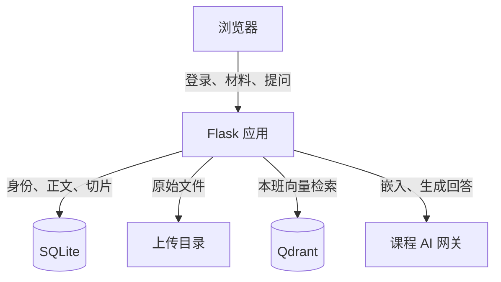

# CampusClaw 身份认证与知识库问答

## 系统架构

CampusClaw 提供班级材料管理、检索和知识库问答。教师上传材料后，系统解析正文、切分片段并建立索引。学生提问时，系统检索本班材料，将相关片段交给模型生成回答，并提供可点击的原文引用。

用户通过 Bearer JWT 访问接口。Flask 应用负责认证和权限检查，SQLite 保存用户、会话、材料正文和切片位置，上传目录保存原文件。Qdrant 保存切片向量，课程 AI 网关提供文本嵌入和回答生成。

## Token 认证与权限控制

### 登录与请求认证

前端向 `POST /api/login` 发送用户名、密码和 `auth_mode=bearer`。后端查询账号并比对密码哈希；验证失败返回 401。验证成功后，后端生成随机会话标识，在 SQLite 中保存关联用户和 12 小时有效期，再签发同样有效期的 JWT。

JWT 使用 HS256 签名，签名密钥由服务端环境变量 SECRET_KEY 派生。登录响应包含 access_token、token_type、expires_in 和用户信息，并通过 `Cache-Control: no-store` 禁止缓存。

| JWT 字段 | 含义与检查方式 |
| --- | --- |
| sub | 用户 ID，必须与会话关联用户一致 |
| jti | 随机会话标识，用于查询有效会话 |
| iat、exp | 签发时间和过期时间，用于检查时间有效性 |
| iss | 签发方，固定为 campusclaw |
| aud | 接收方，固定为 campusclaw-api |

浏览器将 access token 存入当前标签页的 sessionStorage。发送材料、检索和问答请求时，公共请求函数将它加入 `Authorization: Bearer …` 标头；收到 401 后清除本地 token。

服务端收到请求后，依次检查 Bearer 格式、JWT 签名和必需字段，再以 jti 查询有效会话，核对 sub 与关联用户。通过检查后，从数据库读取用户角色和班级，供业务接口使用。显式携带无效 Bearer 的请求返回 401。

### 角色、班级与退出

角色和班级由服务端用户记录确定。材料列表、上传归属、检索范围和模型上下文都限制在当前用户所在班级；请求中的 role 或 class_id 不能改变这些权限。

| 操作或条件 | 处理结果 |
| --- | --- |
| 未登录访问受保护 API | 返回 401 |
| 教师上传材料或重建索引 | 在本班范围执行 |
| 学生调用上传或重建索引接口 | 返回 403 |
| 本班用户查看、下载材料、检索或提问 | 允许访问本班材料 |
| 跨班读取材料、下载文件或重建索引 | 返回 404 |

服务端页面和普通下载链接使用 session Cookie，其中保存随机会话标识，并设置 HttpOnly、SameSite=Lax。Cookie 与 JWT 关联同一个服务端会话。

退出时，前端调用 `POST /api/logout`。后端删除当前会话并清空 Cookie，前端清除 token 后返回登录页。后续请求仍会查询会话，因此旧 JWT 和 Cookie 均无法继续使用。

## 知识库解析与索引

### 文件解析与切片

教师通过 `POST /api/materials` 上传 `.txt` 或 `.md` 文件。后端检查文件大小、UTF-8 编码和非空正文，默认单文件上限为 1 MiB。原文件以随机存储名保存到班级目录，材料记录、完整正文和切片写入 SQLite。

默认每个切片最多 800 个字符，相邻片段重叠 80 个字符，优先在段落、换行或句号处结束。系统也支持按指定分隔符或 Markdown 标题切分。重叠部分保留片段边界附近的上下文，减少切分造成的信息缺失。

每个切片保存材料 ID、班级 ID、序号、标题以及正文中的起止位置。起止位置按字符计数，区间包含起点、不包含终点；切片文字直接取自原文的对应区间。这些记录同时用于检索、引用和原文高亮。

### 关键词与向量索引

关键词索引保存在 SQLite。中文连续文本拆成相邻双字词，英文和数字按词处理，并记录词在各切片中的出现频次。

向量索引使用课程网关的 `course-embedding` 模型。服务端检查返回向量的数量和配置中的 2048 维长度，再写入采用余弦相似度的 Qdrant 集合。向量条目 ID 与 SQLite 的切片 ID 一致，附带班级、材料和切片标识；检索命中后，通过这些标识读取正文。

文件校验失败时返回 400，不建立材料。正文保存成功而向量索引失败时，材料仍可用于关键词检索，索引状态标记为 failed，教师可以重试建立向量索引。

## 检索问答与来源追踪

### 检索相关片段

`POST /api/search` 提供三种检索方式，默认使用混合检索。

| 方式 | 候选片段的获取与排序 |
| --- | --- |
| keyword | 匹配关键词，按词频累计得分 |
| vector | 对问题生成嵌入，在 Qdrant 中查询本班向量，使用 0.35 的相似度门槛 |
| hybrid | 用 RRF 合并关键词与向量排名；片段在两份排名中越靠前，合计得分越高 |

混合检索使用排名融合，避免直接相加口径不同的词频和相似度。向量候选返回后，应用再次核对班级、材料和切片标识，并在 SQLite 中确认切片属于本班且索引状态为 ready，过滤错误或过期的候选。

### 生成回答并定位原文

`POST /api/ask` 接收不超过 500 个字符的问题，执行本班混合检索，最多取 4 个片段。检索完成后，按以下步骤生成回答：

1. 没有相关片段时，返回“资料中未找到相关内容”和空引用列表。
2. 有相关片段时，从 SQLite 读取正文，按 `[1]`、`[2]` 等编号组成模型上下文。
3. 调用 `course-chat`，要求模型依据这些片段简短回答，并标明引用编号。
4. 清除超出片段范围的引用编号，返回回答及引用对应的材料、摘录、原文位置和链接。模型未给出有效引用时，补上 `[1]`。
5. 用户点击引用后，材料页检查班级权限，再按切片的起止位置高亮原文。

无相关片段时不调用生成回答的模型。网关或向量服务不可用时，向量检索、混合检索和问答接口返回 503；关键词检索可以独立运行。

## 运行效果

### Bearer 请求

登录后访问材料列表，浏览器请求携带 `Authorization: Bearer …`，`GET /api/materials` 返回 200。

### 知识库回答

上传科学材料并完成索引后，提问“磁铁能吸木块吗？”，系统回答“不能，磁铁不能吸引木块[1]。”，同时显示引用入口。

### 原文溯源

点击回答中的引用，材料页显示对应正文，并高亮作为回答依据的片段。

