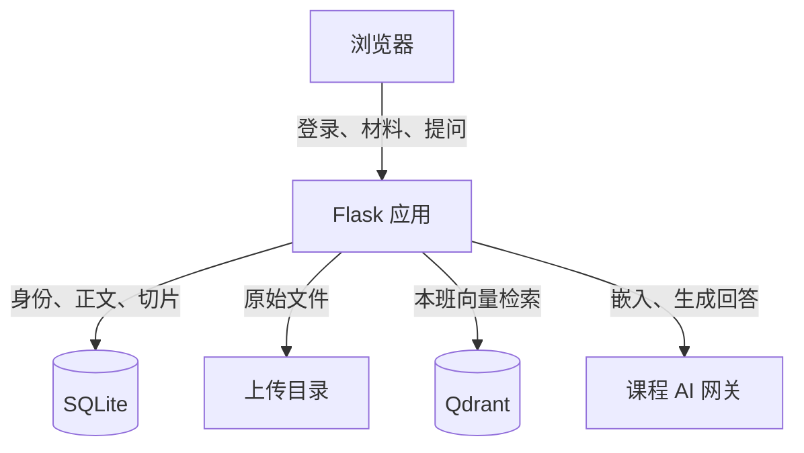
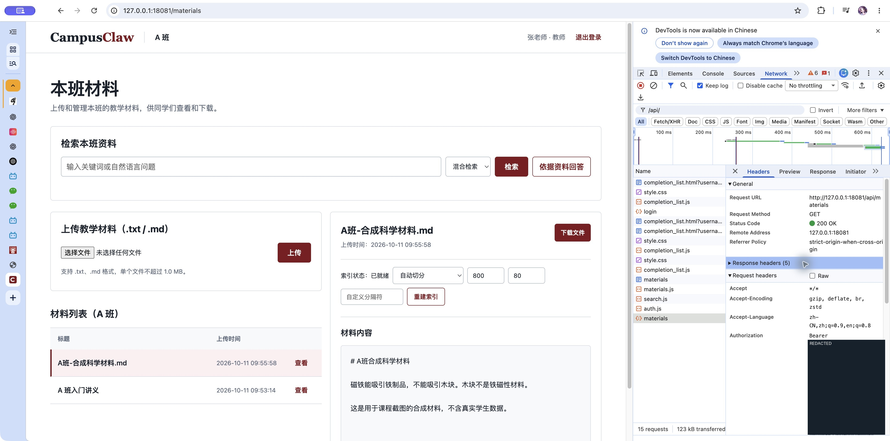
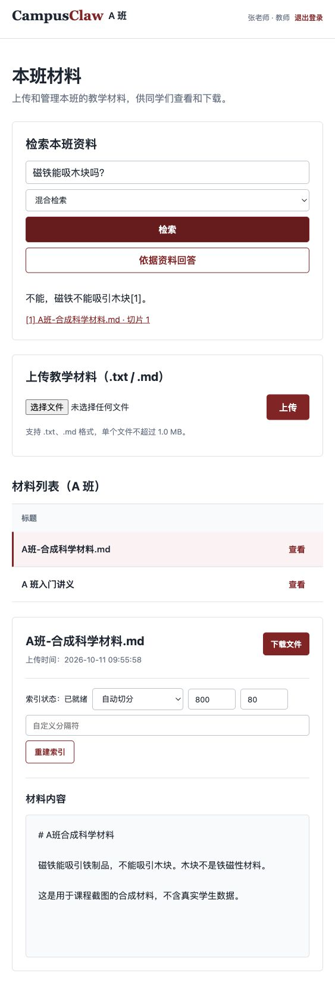
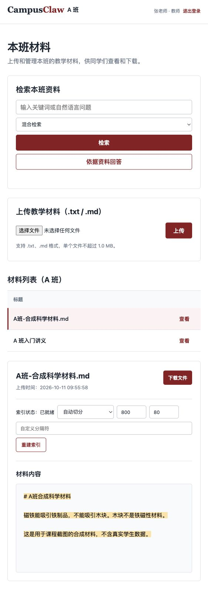

# CampusClaw：Token 身份认证与知识库问答实现方案

课程：互联网软件开发技术与实践。作业：0930 课后任务，整理身份认证以及知识库问答的实现方案。

仓库：[0xkoa1a/CampusClaw](https://github.com/0xkoa1a/CampusClaw)。本文依据本地版本 `897b834` 的实际代码编写；Bearer 功能在 `021091d` 中实现。报告中的运行截图来自独立验收环境，所用材料和账号均为测试数据。

## 实现总览

CampusClaw 为教师和学生提供班级材料管理、检索与简短问答。用户登录后获得 Bearer JWT；服务端验证 token，并查询有效会话和用户表，确认身份、角色与所属班级。提问时，系统只检索该班级的材料，将相关片段交给课程模型生成回答，再返回可点击的来源引用。

两个流程共用同一条权限边界：班级与角色由服务端确定。浏览器传入其他班级编号，不能扩大材料、检索结果或模型上下文的范围。

| 组件 | 保存或处理的内容 | 职责边界 |
| --- | --- | --- |
| 浏览器 | 当前标签页的 access token、页面和引用链接 | 展示结果，发送带身份的请求 |
| Flask / Gunicorn | 登录、鉴权、材料、检索和问答接口 | 所有角色与班级检查的执行位置 |
| SQLite 与上传目录 | 用户、会话、材料正文、切片位置，以及原文件 | 保存权威身份和可追溯原文 |
| Qdrant | 切片向量与标识字段 | 返回候选切片，不保存正文 |
| 课程 AI 网关 | 文本嵌入与基于片段的回答 | 通过服务端私有密钥调用 |

这是单实例课程演示方案。浏览器 token 用于访问 CampusClaw；课程网关 API Key 用于应用访问模型服务，两者用途和保存位置不同。

## Token 登录与请求认证

### 登录与 token 签发

前端向 `POST /api/login` 发送用户名、密码和 `auth_mode=bearer`。后端用用户名查询账号，通过 Werkzeug 比对密码哈希；密码错误返回 401，错误的认证模式返回 400。

验证通过后，后端生成随机会话标识 sid，在 SQLite 的 sessions 表保存用户关联和 12 小时有效期。当前客户端已有旧会话时，先删除该会话，再建立新会话。JWT 的有效期同为 12 小时，响应包含 access_token、token_type、expires_in 和身份摘要，并设置 `Cache-Control: no-store`。

JWT 使用固定 HS256 算法签名。签名密钥由私有环境变量 SECRET_KEY 按专门用途派生，不写入代码或公开仓库。JWT 的载荷用于识别用户与会话，不保存密码、角色授权或班级授权。

| JWT 字段 | 当前含义 | 验证用途 |
| --- | --- | --- |
| sub | 用户 ID 的字符串 | 必须与会话关联用户一致 |
| jti | 本次随机会话 sid | 查询服务端是否仍存在有效会话 |
| iat、exp | 签发时间、过期时间 | 检查时间有效性 |
| iss | campusclaw | 限定签发方 |
| aud | campusclaw-api | 限定 token 接收方 |

### 请求中的身份识别

浏览器将 access token 存入当前标签页的 sessionStorage。公共请求函数读取它，在材料、检索、问答和退出请求中加入 `Authorization: Bearer …`。收到 401 时清除本地 token。

服务端按以下顺序处理受保护请求：

1. 读取 Authorization 标头，检查 Bearer 方案和 token 格式。
2. 固定使用 HS256 校验签名，并要求 sub、jti、iat、exp、iss、aud 全部存在且有效。
3. 以 jti 查询未过期的服务端会话，关联用户与班级表。
4. 核对 sub 与实际用户 ID，将当前身份提供给业务接口。

JWT 验证通过后仍要查会话。这使系统可以主动撤销登录；只有签名正确但会话已删除的 token，也会返回 401。请求显式携带无效 Bearer 时，服务端直接按未认证处理，即使同时有有效 Cookie，也不会用 Cookie 接受该请求。

## 权限控制、Cookie 兼容与安全边界

### 角色与班级

材料列表、上传归属、检索范围和问答范围，都取自服务端当前用户的 class_id。角色也从用户表读取。修改请求里的 role、class_id、查询参数或自定义标头，不会修改当前身份。

| 操作或条件 | 服务端行为 |
| --- | --- |
| 未登录访问受保护 API | 返回 401；页面访问则跳转登录页 |
| 教师上传本班材料或重建本班索引 | 允许，并由服务端确定班级 |
| 学生直接调用上传或重建索引接口 | 返回 403，不依赖按钮是否隐藏 |
| 本班用户查看、下载材料、检索或提问 | 在本班范围执行 |
| 跨班读取材料、下载文件或重建索引 | 返回 404，与不存在的资源同形 |
| 伪造班级参数或混入跨班向量 point | 忽略参数，过滤不属于本班的候选 |

### Cookie 与退出

服务端页面和普通下载链接继续使用签名 session Cookie，其中只保存随机 sid。Cookie 设置 HttpOnly、SameSite=Lax；Secure 由部署配置控制。JavaScript 未启用时，普通表单登录仍可工作。API 登录省略 auth_mode 时默认使用 Cookie。

退出时，前端调用 `POST /api/logout`。后端删除当前会话并清空 Cookie，前端清除 token 后返回登录页。由于 JWT 与 Cookie 指向同一会话，退出后重放这两个旧认证值都会失败。该方案保留服务端会话状态，每个受保护请求需要访问数据库。

### 当前安全边界

Bearer token 持有者可以使用该身份，因此应在 HTTPS 或受保护隧道中传输。sessionStorage 可以被同源脚本读取，需要继续防范 XSS；JWT 签名保证完整性，并不加密载荷。

当前实现没有 refresh token、登录限流、MFA 或独立 CSRF token。SameSite=Lax 提供部分跨站限制，不能代替完整的公网安全设计。课程网关密钥仅保存在服务端私有配置；截图中的测试认证值已经撤销并遮盖。

## 知识库材料的解析与索引

### 从文件到可追溯切片

教师通过 `POST /api/materials` 上传文件。后端接受 `.txt` 和 `.md`，检查大小上限、UTF-8 解码和非空正文；默认单文件上限为 1 MiB。当前没有 PDF、Word 或图片解析，也没有独立 MIME 检测。

原文件使用随机存储名放入班级目录。SQLite 事务写入材料记录、完整正文和知识切片。切片同时保存 material_id、class_id、chunk_index、heading、start_offset 和 end_offset，使每个片段都能回到正文中的确切位置。

默认切片最多 800 个字符，相邻片段重叠 80 个字符；优先在段落、换行或句号处结束。系统还支持指定分隔符和 Markdown 标题切分。教师重建索引时可以调整策略；字符数范围为 100 至 2000，重叠量不得超过切片大小的一半。

原文位置使用 Python 字符串索引，左闭右开，不是 UTF-8 字节偏移。切片正文等于原文的对应区间，切分不改写文字，因此检索结果可以准确高亮原文。

### 关键词与向量索引

关键词索引保存在 SQLite。中文连续文本拆成相邻双字词，英文和数字按词处理，记录每个词在切片中的出现频次。

向量索引由服务端调用课程网关的 `course-embedding` 模型，检查返回数量和配置中的 2048 维长度，再写入采用 Cosine 距离的 Qdrant 集合。point ID 与 SQLite 的 chunk_id 一致；payload 只保存班级、材料、知识条目和切片标识，不包含正文。

上传正文成功但向量服务失败时，接口仍返回 201，同时标记 `index_status=failed`。原文件、正文和关键词切片保留，教师可以重试向量索引。格式校验失败则返回 400，不建立材料；数据库事务失败会回滚并清理刚写入的原文件。向量库与 SQLite 之间没有跨系统事务。

## 本班检索、模型问答与来源追踪

### 检索候选

`POST /api/search` 支持 keyword、vector、hybrid 三种模式，默认 hybrid。关键词模式按匹配词频累计得分；向量模式对问题生成嵌入，向 Qdrant 查询本班候选，并使用 0.35 的相似度门槛。

向量结果返回后，应用还核对 payload 的班级、切片 ID 和材料 ID，再从 SQLite 查询同班且索引状态为 ready 的切片。Qdrant 中错误或过期的候选不会直接进入返回结果。

混合模式用 RRF 融合两份排名。同一切片分别从关键词和向量排名获得分数，再按合计分数排序；排名越靠前，贡献越大，平滑常数为 60。这避免直接相加口径不同的词频与相似度。

### 从候选到带引用的回答

`POST /api/ask` 接收不超过 500 个字符的问题，并执行本班混合检索，最多取 4 个片段。处理顺序为：

1. 没有检索片段时，直接返回“资料中未找到相关内容”和空引用列表，不调用对话模型。
2. 有片段时，按本班条件从 SQLite 读取片段的完整正文，编号后组成模型上下文。
3. 调用课程网关的 `course-chat`，要求只依据编号资料简短回答，并用 `[1]` 等标明来源。
4. 清除回答里超出片段数量的引用编号，返回实际使用的编号及其材料、偏移、摘录和 source_url。
5. 用户点击引用，材料页重新检查权限，并按切片偏移高亮原文。

接口接受可选 history 数组，最多 12 条；网关客户端只采用其中最后 6 条格式有效的 user / assistant 消息，每条最多 2000 个字符。当前没有独立的长对话存储、流式输出或第五课工作流。

引用校验检查编号范围，不能证明回答中的每句话都受到片段支持。模型未提供有效引用时，当前代码补 `[1]`，这一规则提供可定位来源，但仍需要人工核对回答与证据是否一致。

> “无证据不调用模型”指不调用生成回答的对话模型。默认混合检索仍可能调用嵌入服务；若网关或 Qdrant 故障，向量、混合检索和问答返回 503。用户仍可使用不依赖这些服务的关键词检索，系统没有自动把问答降级为关键词回答。

## 运行效果与验收证据

### Bearer 请求

下图是 Chrome Network 中实际发送的材料请求。Authorization 使用 Bearer 方案，`GET /api/materials` 返回 200。截图中的 JWT 已从测试会话表撤销，再遮盖认证值；身份、接口和状态码保留。

该截图使用教师账号；自动化测试另覆盖 A 班教师、A 班学生和 B 班学生在完全没有 Cookie 时的 Bearer 访问。

### 知识库回答

教师实际上传合成科学材料，材料 ID 为 3，向量状态为 ready。提问“磁铁能吸木块吗？”，真实课程网关返回“不能，磁铁不能吸引木块[1]。”。下图保留了问题、模型回答和引用入口。

### 原文溯源

点击回答中的引用后，系统打开同一材料的正文并高亮实际切片。材料标题、切片标识和偏移来自检索记录；页面再次检查用户和材料是否属于同班。

### 验收范围

自动化测试包含 JWT 签名、过期、issuer / audience、必需字段、sub 与会话绑定、非法 Bearer 不回退、登出后重放、角色与班级隔离，也包含切片偏移、三种检索、跨班候选过滤、引用、无片段不调用对话模型和依赖服务故障。完整测试集为 51 项。

自动化检索与问答测试使用可控的替代模型和向量库；上面的 AI 回答截图使用真实课程网关。两类证据分别验证分支行为和真实联通效果。截图中的测试会话已撤销，未脱敏原图没有进入仓库。

截图环境是 CLab 的独立测试容器，数据库、上传目录和 Qdrant 集合与既有正式服务隔离。报告描述的 Bearer 代码尚未同步到原正式服务，截图不表示原正式服务已完成升级。既有第四课验收记录另外保存了真实向量、引用及容器重建后数据保留的结果。

## 部署与复核

应用由 Docker Compose 启动，Flask / Gunicorn 同时提供页面和 API。应用端口绑定宿主机 `127.0.0.1:8080`，远程使用 SSH 隧道访问；Qdrant 没有宿主机端口映射。SQLite、上传文件和向量数据使用命名卷持久保存，普通容器重建保留数据，删除 volume 会删除数据。

首次运行先用 `scripts/setup_env.py` 生成私有配置，在 `.env` 中填入课程网关 API Key，保持权限 0600；然后执行 Compose 构建启动、`scripts.reindex_all` 与 `scripts.verify_retrieval`。已有配置不能重新覆盖。具体命令与 SSH 访问方法保存在仓库 README。

复核时，先运行完整 pytest 与 OpenSpec strict 校验，再检查三种检索、引用跳转、跨班拒绝，以及容器重建前后的材料和向量持久化。`scripts.verify_retrieval` 仅允许已授权的合成验收材料；遇到其他正文立即退出，避免把未确认授权的课程材料送往外部模型服务。

当前版本适合受限网络中的单实例课程验收。公网发布还需要完善 HTTPS、登录限流、CSRF 防护、会话维护、监控与跨存储失败恢复。回答中的编号引用提供来源定位，答案正确性仍需结合原文核对。

## 实现与要求来源

作业原文要求“结合现有代码梳理基于token的身份认证以及基于知识库问答的实现方案”，并提交 PDF。原页面为[0930 课后任务](https://w.ketangpai.com/homework?id=MDAwMDAwMDAwMLR2z92IqatshLVyoQ&courseId=MDAwMDAwMDAwMLOcx5aH37ewhbVyoQ&courseRole=0)，需要课程账号登录；截止时间以已留档页面为准，为 2026-10-15 00:00。

| 核对内容 | 仓库内的实现或记录 |
| --- | --- |
| Token 签发、认证、撤销与浏览器携带 | `app/auth.py`、`app/static/auth.js` |
| 材料权限、上传、下载和来源高亮 | `app/materials.py`、`app/db.py`、`app/chunking.py` |
| 关键词、向量、混合检索和二次过滤 | `app/retrieval.py`、`app/vector.py`、`app/indexing.py` |
| 问答、引用处理与课程网关 | `app/search.py`、`app/gateway.py` |
| 认证与问答分支测试 | `tests/test_bearer.py`、`tests/test_retrieval.py` |
| 规约与真实环境验证 | `openspec/changes/add-bearer-login/`、`openspec/specs/traceable-retrieval/spec.md`、`docs/week04-verification.md` |
| 作业与截图原始记录 | `docs/classroom/requirements.md`、`docs/classroom/evidence.md` |

本文、配套自包含 HTML 和 PDF 均按 0930 作业日期归档。GitHub 推送和课堂派提交由学生另行处理。
