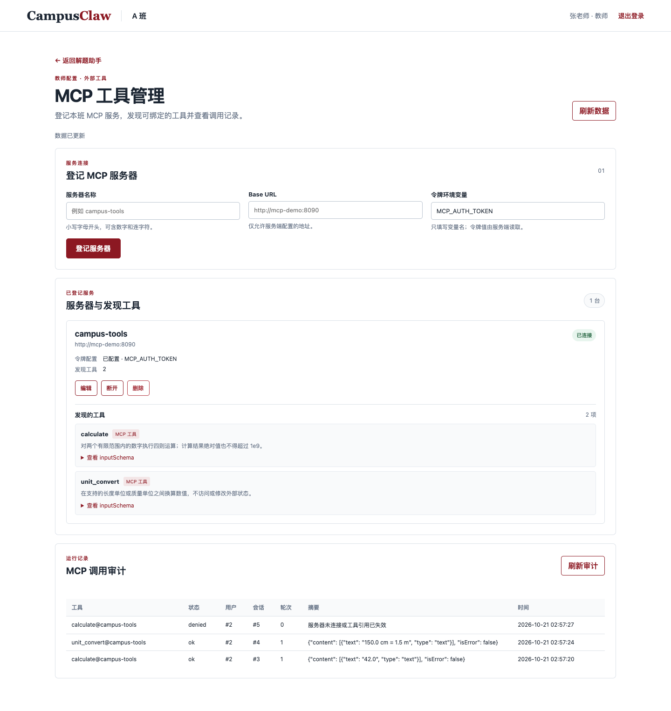
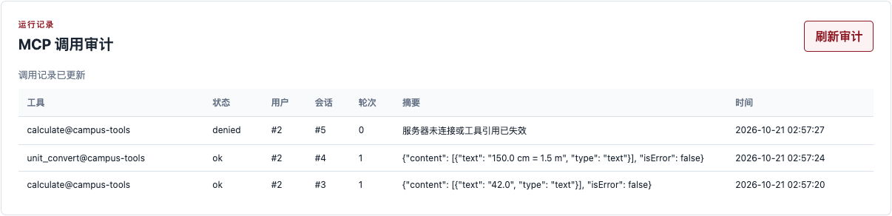

# 个人AI应用平台与MCP验证报告

## 项目介绍

Git 仓库：[0xkoa1a/CampusClaw](https://github.com/0xkoa1a/CampusClaw)。

CampusClaw 是面向班级学习的 AI 应用平台。教师上传课程材料，配置应用的提示词、技能和可用工具；学生选择应用提问，查看流式回答、资料引用和历史对话。平台按班级隔离资料，按用户隔离会话，权限由服务端检查。

Flask 提供页面与接口，SQLite 保存账号、材料、技能、会话和调用记录，Qdrant 保存知识切片向量，课程网关提供嵌入和对话模型。独立的 HTTP MCP 服务提供四则计算与单位换算，和主应用通过 Docker Compose 一起启动。

| 功能 | 项目实现 |
| --- | --- |
| 多个 AI 应用 | 各应用独立保存角色提示词、技能与资料绑定；验证中配置学习问答、四则计算、单位换算三个应用 |
| 提示词模板 | 内置解题引导、材料问答、计算核对模板，选择后可编辑并保存到应用 |
| 知识库检索 | 上传 TXT/Markdown，切片后建立关键词与向量索引；按当前班级及应用绑定范围混合检索 |
| 内置与上传 Skill | 提供计算核对、阅读定位样板；教师可导入文件、编辑、启停并绑定到应用 |
| 外部工具与 MCP | 教师登记服务器、握手发现工具；技能用 `calculate@campus-tools` 等引用绑定；服务端鉴权调用并记录审计 |



## 验证方法

在 CLab 上以独立 Compose 项目运行应用、Qdrant 和 MCP 服务，使用合成账号与资料发送真实课程网关请求。调用记录直接从网关发送和接收处采集，包含请求体、上游返回、MCP 报文及最终保存的回答。传输认证头不进入记录。

五个主要场景是普通问答、知识问答、四则计算、单位换算和断开 MCP 后的问答。完整数据保存在同目录的 `模型与MCP调用验证.json`；长文档检索另见 `知识库范围验证.json`。

| 场景 | 实际结果 |
| --- | --- |
| 普通问答 | 未发送工具声明，完成流式回答 |
| 知识问答 | 命中数学解题引导技能，返回带资料编号的提示 |
| 四则计算 | 模型请求 `calculate`，MCP 返回 42，最终回答“23 + 19 的结果是 42。” |
| 单位换算 | 模型请求 `unit_convert`，MCP 返回 1.5，最终回答“150 cm 换算为 m 的结果是 1.5 m。” |
| 断开 MCP | 调用状态为 denied，没有发送远端 tools/call，仍返回完整回答并说明工具不可用 |

## 每次对话向 LLM 传递什么，模板是否一起发送？

角色提示词会一起发送。它与平台规则、当前命中技能的正文组成 `system` 消息；检索片段与当前提问进入 `user` 消息。多轮对话还会带入历史窗口中的消息，单条历史最多 500 字。当前提问只进入上下文一次。

实际普通流式请求发送到 `/chat/completions`，参数如下。

| 字段 | 记录中的值或内容 |
| --- | --- |
| model | course-chat |
| messages | system、历史窗口、当前 user 消息；有工具时还包含 assistant 工具请求与 tool 结果 |
| stream | 最终回答为 true；工具规划阶段为 false |
| temperature | 0.2 |
| max_tokens | 450，表示客户端发送的参数 |
| tools / tool_choice | 仅工具规划请求包含；分别为当前候选工具声明和 auto |

知识问答记录中的 system 消息以“你是课程学习助手，只依据当前问题、绑定资料和可用工具作答。”开头。这与应用保存的角色提示词一致，随后包含“技能：数学解题引导”及其规程正文，证明模板并非只保存在界面中。

上游流式响应包含 `choices[].delta.content`；部分帧还包含 `reasoning_content`、`finish_reason` 或 `usage`。页面只将 content 增量作为回答显示。服务端保留原始帧，再将过滤引用编号后的正文写入消息表；应用另加的引用文字与模型原文在记录中可以区分。验证逐字核对了页面接收的正文与数据库中保存的正文。

## 绑定知识库后，是否每次发送全部内容？

不会固定发送整个知识库。服务端先限制当前班级与应用绑定材料，再进行关键词、向量混合排序，最多取四条结果；过滤技能指定的资料范围和空正文后，将切片正文放入当前 user 消息，每片最多 800 字。没有命中资料时仍可以回答，但引用为空。

本次知识问答的请求包含方程材料和语文材料的两个切片，未包含另行上传但未绑定的 `WEEK06_UNBOUND_SECRET_MARKER` 资料。语文材料虽然与解方程无关，仍进入了前四名候选，说明“检索得到”不等于“必然相关”。这次两份绑定材料都很短，不能据此声称短资料一定只会部分发送。

为进一步区分“绑定范围”与“实际发送范围”，另用八个带独立标记的章节组成长文档，每节约 650 字，只绑定该文档。真实请求带入四个切片，包含八个章节标记中的五个，没有包含完整文档。切片可以跨越章节边界，因此四片并不等于四章；这证明发送范围取决于检索切片，而非整份绑定文档。

## 绑定 Skill 后，是否包含技能的全部内容？

只发送本轮选中的技能名称与完整规程正文，并非发送所有绑定技能或整份上传文件。

技能文件包含名称、适用条件、资料范围、工具、启用状态和正文。适用条件用于路由计分，资料字段限制检索，工具字段决定候选工具，启用状态决定是否参与路由；这些字段主要由宿主程序使用。选中的规程正文进入 system 消息。

验证应用同时绑定数学与语文技能。提问含“方程”时，实际请求包含完整的 `W6_MATH_SKILL_BODY_SENTINEL` 规程，未包含 `W6_UNHIT_SKILL_BODY_SENTINEL` 语文规程。上传文件中的字段标签也没有作为一个完整文件整体传给模型。

## Skill 如何执行？

技能是由宿主解释的配置与规程。服务端从当前应用绑定且启用的技能中，根据适用条件的关键词计分选出一个；同分选编号较小的技能，零分不选。随后读取其资料范围、正文与工具引用，组装本轮上下文。

普通指导技能通过提示词影响模型回答；带 MCP 引用的技能还会把已发现的工具声明交给模型。模型提出工具名和参数后，宿主检查候选集合、班级归属、服务器连接状态和参数结构，才执行外部调用。因此，上传技能正文不会直接成为 Python 或 shell 程序。

例如，计算问题命中“MCP四则计算”，宿主提供 calculate 的参数结构，模型选择 add、23、19，MCP 服务计算并返回 42，宿主将结果作为 tool 消息交回模型，再生成最终流式回答。

调用循环最多两轮、累计四次工具执行，并检查时间预算。达到上限后使用已有信息回答。工具错误会作为失败数据返回模型；含已知指令式诱导的结果会被替换为固定说明。该文本检查不能替代权限和参数校验。

## 接入 MCP 后，LLM 请求增加了什么？

LLM 接收的是函数工具声明，MCP 报文由宿主发送。服务器地址和 Bearer 令牌都不进入模型请求。

四则计算场景的第一次请求包含以下真实数据结构：

```json
{
  "type": "function",
  "function": {
    "name": "calculate",
    "parameters": {
      "type": "object",
      "required": ["operation", "a", "b"],
      "additionalProperties": false
    }
  }
}
```

这里摘录名称与结构约束；完整声明还包含发现时的工具说明、operation 的四个枚举值，以及 a、b 的数值范围。验证核对了传给模型的 parameters 与发现缓存中的 inputSchema 完全相同。

模型返回 `assistant.tool_calls`，其中 function.name 为 calculate，arguments 为 `{"operation":"add","a":23.0,"b":19.0}`。宿主校验后发送如下 MCP 请求体：

```json
{
  "jsonrpc": "2.0",
  "id": "513f7297417c4cab",
  "method": "tools/call",
  "params": {
    "name": "calculate",
    "arguments": {"operation":"add","a":23.0,"b":19.0}
  }
}
```

响应返回同一 id。MCP 结果为 content 文本数组，文本是“42.0”，isError 为 false。下一次模型请求包含先前的 assistant 工具请求，以及 `role: tool`、匹配的 tool_call_id 和结果正文。模型确认无需继续调用后，宿主发起最终流式请求。

实际计算与换算场景均经过两次非流式规划请求和一次最终流式请求。换算参数为 value=150、from_unit=cm、to_unit=m。两种工具都留下了 ok 审计，包含用户、会话、轮次、时间与结果摘要。



真实 MCP HTTP 鉴权检查中，缺失令牌和错误令牌均返回 401，正确令牌返回 200 并发现两个工具。断开服务器后，缓存清空，既有技能的调用变为 denied；请求记录中没有新的 tools/call，模型如实说明工具不可用。教师审计按班级授权，完整模型记录只对会话所有者开放。
